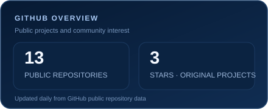
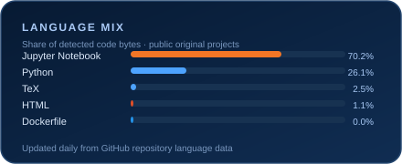

<!-- Premium navy and electric-blue profile header -->

  

  

  
  
  

  <a href="#about">About</a> ·
  <a href="#experience">Experience</a> ·
  <a href="#selected-projects">Projects</a> ·
  <a href="#skills--areas">Skills</a> ·
  <a href="#github-activity">GitHub activity</a> ·
  <a href="#connect">Connect</a>

---

## About

I’m **Saish Thakur**, an Information Technology undergraduate at **Manipal Institute of Technology**. I enjoy building practical software and exploring how machine learning and generative AI can solve real problems.

- 🎓 B.Tech in Information Technology, MIT Manipal
- 💼 Former Data Science Intern at the National Payments Corporation of India (NPCI)
- 🔎 Interested in machine learning, NLP, LLMs, retrieval-augmented generation, and backend systems

## Experience

**Data Science Intern · National Payments Corporation of India (NPCI)**

Contributed to work on LLM-assisted synthetic banking conversation data, including scenario and customer-journey design and high-level data quality checks.

## Selected Projects

A selection of academic and independent projects across generative AI, retrieval, and machine learning.

### [CloudRAG](https://github.com/saishthakur/cloud-native-rag)
A cloud-native RAG system exploring multi-tenant document retrieval, retrieval routing, and secure knowledge access.

**Focus:** Python · RAG · LLMs · distributed systems

### [Synthetic Banking Dataset Generator](https://github.com/saishthakur/sdg-banking-dataset-generator)
An agentic framework for turning banking-domain documents into synthetic customer-support conversations, with validation and review steps.

**Focus:** Python · LLMs · synthetic data · evaluation

### [English–Hindi Translation with Generative Models](https://github.com/saishthakur/generative-ai-machine-translation)
Compares encoder–decoder models with prompted LLaMA 3.2 1B and Gemma 3 1B on English-to-Hindi translation, with documented evaluation and limitations.

**Focus:** Generative AI · transformers · machine translation · model evaluation

### [Autoregressive Text Generation](https://github.com/saishthakur/Foundation-of-GenAI)
Implements and compares RNN, BiRNN, LSTM, and GRU models for next-word text generation, including an exploration of sampling temperature.

**Focus:** Generative AI · recurrent neural networks · text generation

### [Fake News Detection with Deep Learning](https://github.com/saishthakur/Deep-Learning-Project)
A comparative study of MLP, CNN, LSTM, and DistilBERT for fake-news classification on the ISOT dataset. The project notes that dataset classification does not verify the truth of an article’s claims.

**Focus:** Deep learning · NLP · text classification

## Skills & Areas

**Programming:** Python  
**Machine learning:** machine learning · deep learning · NLP · text classification · model evaluation  
**Generative AI:** LLM applications · RAG · synthetic data generation · transformer models  
**Interests:** backend systems · distributed systems · responsible evaluation

## GitHub Activity

  
  

  <a href="https://github.com/saishthakur">
    <picture>
      <source media="(prefers-color-scheme: dark)" srcset="https://raw.githubusercontent.com/saishthakur/saishthakur/output/github-contribution-grid-snake-dark.svg" />
      <source media="(prefers-color-scheme: light)" srcset="https://raw.githubusercontent.com/saishthakur/saishthakur/output/github-contribution-grid-snake.svg" />
      
    </picture>
  </a>

Analytics cards and the contribution animation are refreshed automatically by GitHub Actions.

## Connect

  
  

Building, learning, and sharing along the way.

  

